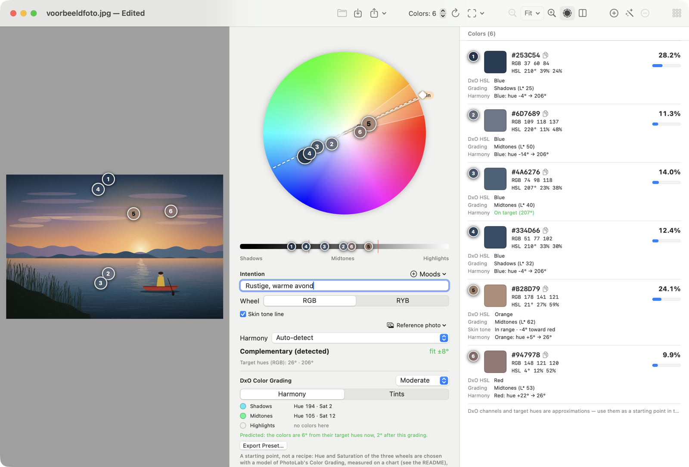
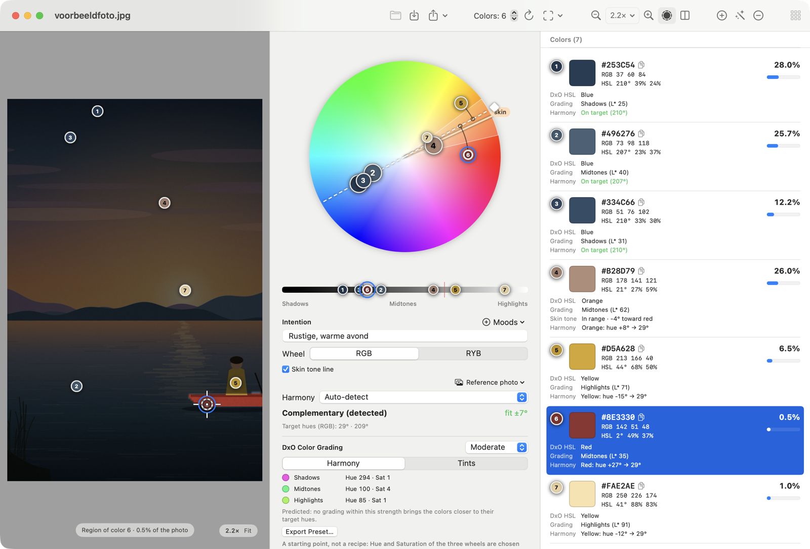
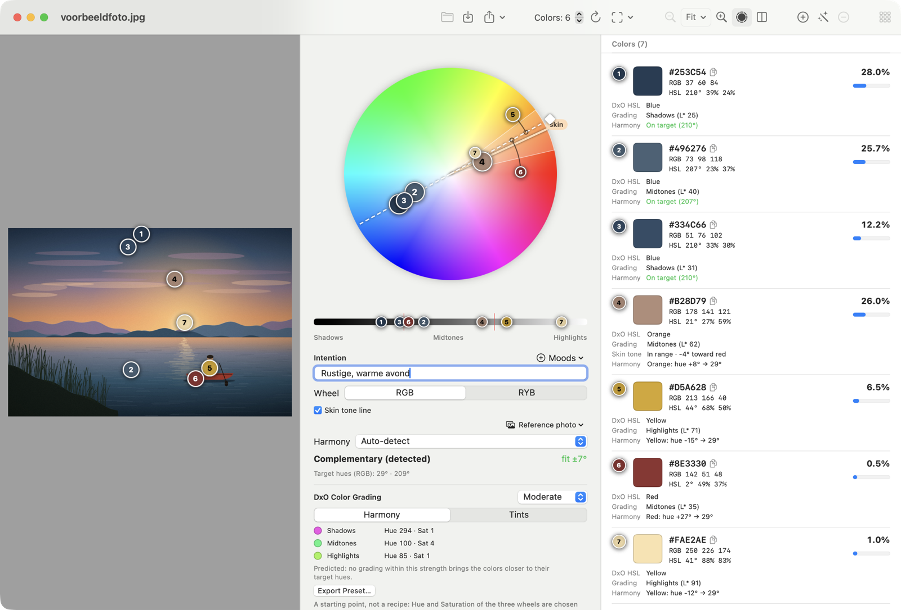
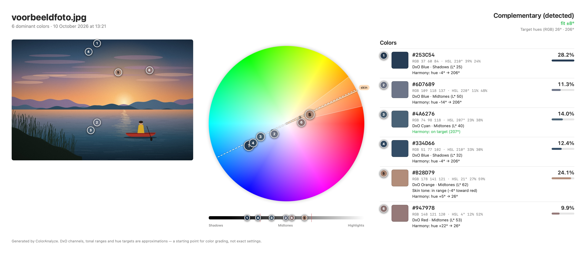

# ColorAnalyze in 10 minuten

Van foto naar een startpunt voor color grading in DxO PhotoLab, met de meegeleverde voorbeeldfoto [`voorbeeldfoto.jpg`](voorbeeldfoto.jpg): een avond aan een meer, met een klein rood bootje en een figuur in een gele jas. (Een getekende illustratie, geen echte foto; het gaat om de kleuren.)

## 1. Open de foto en schrijf je intentie op

Start de app (`build/ColorAnalyze.app`, zie de README) en open de foto met **⌘O** of sleep hem in het venster. Vul meteen het veld **Intention** in, vóór je naar de kleuren kijkt: *Rustige, warme avond*. De harmonie die je straks kiest moet dát gevoel dienen, niet andersom.

Wat je ziet:

- **Links** de foto met genummerde markers op de dominante kleurvlakken.
- **Midden** het kleurwiel met dezelfde markers, de huidtintlijn, een helderheidsbalk en de gedetecteerde harmonie (hier *Complementary*, oranje ↔ blauw: de klassieke zonsondergang).
- **Rechts** de lijst: hex, RGB, HSL, aandeel in de foto, het DxO-kanaal (bijv. *Blue*, *Orange*) en het toonbereik (Shadows / Midtones / Highlights).

## 2. Controleer wat de analyse mist

De automatische analyse kijkt naar oppervlak. Op de voorbeeldfoto levert dat vooral blauwtinten op, plus wat wolk. Het kleine bootje en de zon — precies waar het oog naartoe gaat — ontbreken. Dat is normaal: **oppervlak ≠ belang**.

## 3. Corrigeer de markers

- **Slepen**: pak een marker en zet hem op een ander deel van de foto; wiel en lijst volgen direct.
- **Suggest Marker** (de toverstaf in de toolbar, ⌥⌘M) voegt een marker toe op de kleur die nog geen marker heeft. Op de voorbeeldfoto vind je zo met een paar keer klikken de donkere oever, de oranje gloed, de gele jas en het rode bootje.
- **Dubbelklik** op de foto voegt een marker toe. **Selecteren + de min-knop (toolbar)** of rechtsklik ▸ *Remove Marker* verwijdert er een.
- **Inzoomen voor precisie**: ⌘-scroll of knijp (pinch) op de plek waar je wilt zijn, scroll of sleep om te verplaatsen, **⌘0** is weer de hele foto. Bij een geselecteerde marker toont een ring het gebied waarover de kleur wordt gemiddeld, met een stip op de exacte plek.

Voor de voorbeeldfoto: zoom in op het bootje, dubbelklik op de gele jas (marker 5) en op de rode romp (marker 6). Selecteer een marker en je ziet de **regio** van die kleur oplichten (hier de romp: 0,5 % van de foto) — handig om te zien waar een DxO-lokale aanpassing moet komen.

Zoom daarna terug (⌘0), verwijder de dubbele blauwen en zet een marker op de zon (marker 7). Resultaat: de blauwe schaduwen, het warme huidtint-achtige wolkenoranje, de gele jas, het rode bootje en de zon staan nu allemaal in het palet.

## 4. Lees het wiel en de harmonie

- *Harmony → Auto-detect* kiest het sjabloon dat het best past (hier *Complementary*, fit ±7°). Kies zelf een ander sjabloon of draai het met de handle aan de rand van het wiel.
- In de lijst staat per kleur wat er moet gebeuren: *Orange: hue +8° → 29°* betekent dat die kleur 8° richting het doel moet schuiven. **Groen = op doel.**
- *Skin tone*: kleuren in de huidtintband krijgen een regel erbij. Het is een vuistregel, geen huiddetectie.
- Het DxO-kanaal en de hue-waarden zijn benaderingen op DxO's eigen kleuras. Controleer ze in PhotoLab.

## 5. Naar DxO PhotoLab

Onder het wiel staat het vak **DxO Color Grading** met per toonbereik een voorgestelde **Hue** en **Sat**. Er zijn twee manieren om dat in PhotoLab te krijgen. Beide geven een startpunt, geen recept: stel altijd bij op je oog en je intentie.

**Eerst kijken wat het voorstel doet:** zet onder het wiel **Preview on the photo** aan (of druk op `P`). Rechts van de verdeellijn zie je de foto met de voorgestelde waarden toegepast, links het origineel; sleep de lijn om te vergelijken. Met *×2* of *×4* worden de tinten overdreven, handig als het voorstel klein is. Sinds de kalibratie klopt de preview goed met PhotoLab (zie de README), en met de preview aan zie je op het wiel ook waar elke kleur volgens het model terechtkomt (stippellijn-bolletjes) en in de lijst een regel *Predicted …* met de huidtintband voor en na. Onder het voorstel staat hoe ver de kleuren van hun doel zijn, nu en na de grading. Je ziet meteen of bijvoorbeeld het rode bootje oranje wordt.

**Een stijl erbij:** naast de sterkte staat in hetzelfde vak het menu **Style**. *Neutral* is alleen "kleuren naar hun doel". Kies *Warm highlights, cool shadows* (of andersom) en de grading geeft ook de shadows en highlights een eigen zweem, bijvoorbeeld warme lichten tegen koele schaduwen, ook als die bereiken zelf geen kleuren hebben. Er zijn er meer: *Teal & orange (cinematic)* is hetzelfde met sterkere kleuren, *Warm overall* en *Cool overall* leggen een zweem over de hele foto met het **Master**-wiel (in PhotoLab het wiel *Global* in het Color Grading-palet; het vak noemt het *Master*), ten koste van de kleurfit, en *Faded (lighter shadows)* tilt de schaduwen op zonder zweem, met de schuifregelaars **Blacks** en **Shadows** van het palet **Light** (module *Selective Tone*). Het vak toont daarvoor een blok *Light palette, Selective Tone*; die twee waarden zet je met de hand in (een Color Grading-preset kan ze niet dragen). Een pixel die precies zwart is blijft zwart. Staat er in je **Intention** een woord als *warm*, *warme avond* of *koel*, dan stelt de app de passende stijl zelf voor, met een knop **Use**; er verandert niets tot je klikt. Dat gaat ten koste van een stukje van de kleurfit; de regel *Predicted* onder het voorstel laat zien hoeveel. Kijk altijd in de preview.

### 5a. Met een preset (snel)

Kies de sterkte (*Subtle / Moderate / Strong*) en klik **Export Preset…**. Het `.preset`-bestand komt in PhotoLabs eigen map (`~/Library/DxO PhotoLab v10/ColorGradingPresets`) en verschijnt daar in de lijst van het **Preset**-menu van het Color Grading-palet, als *voorbeeldfoto – ColorAnalyze*.

### 5b. Handmatig, zonder preset

Wil je de preset niet gebruiken, of zelf bepalen wat je overneemt? Voer de voorstellen dan met de hand in. De namen hieronder zijn die uit PhotoLab 10 zelf (palet **Color Grading** en palet **HSL**).

**Voorbereiding**

1. Doe eerst de basiscorrecties in PhotoLab: **witbalans, belichting en contrast**. Een witbalansverschuiving verschuift alle kleuren, dus analyseer en grade pas daarna. (Analyseer bij voorkeur een kleine export uit PhotoLab, bijvoorbeeld 2000 px, en niet de RAW zelf.)
2. Houd het ColorAnalyze-venster open naast PhotoLab. Alles wat je nodig hebt staat in het vak **DxO Color Grading** (onder het wiel) en in de kleurenlijst (rechts).

**Deel 1: Color Grading, de grote lijnen (3 handelingen)**

Dit zet de algemene tint per toonbereik. Voorbeeld voor de voorbeeldfoto, zoals ColorAnalyze die voorstelt:

| Toonbereik | Voorstel in ColorAnalyze | Wat je in PhotoLab invult |
|---|---|---|
| Shadows | Hue 294 · Sat 1 | Hue **294**, Saturation **1** |
| Midtones | Hue 100 · Sat 4 | Hue **100**, Saturation **4** |
| Highlights | Hue 85 · Sat 1 | Hue **85**, Saturation **1** |

De voorbeeldfoto zit al dicht bij zijn harmonie (de kleuren zijn gemiddeld 6° van hun doel), dus het voorstel is klein; bij een foto die verder afwijkt zie je grotere waarden. Let ook op dat de Hue van een wiel zelden de tint van het doel is: PhotoLab telt de tint per kleurkanaal op in een breed kleurgebied, en het model kiest de Hue die de kleuren echt dichter bij hun doel brengt (zie de README).

1. Open in PhotoLab het palet **Color Grading**.
2. Kies bovenin het toonbereik: **Shadows**, **Midtones** of **Highlights** (de keuzes naast *Global*).
3. Vul onder het kleurenwiel de velden **Hue** en **Saturation** in met de getallen uit ColorAnalyze (typen in de velden kan; slepen van het stipje in het wiel kan ook, hoe verder van het midden hoe sterker de verzadiging). Laat **Luminance** op 0, tenzij het vak er een getal bij noemt (*Lum*; dat gebeurt zelden).
4. Herhaal stap 2 en 3 voor elk toonbereik dat een voorstel heeft.
5. Regels met *already on target* of *no colors here* laat je ongemoeid. **Master** (het eerste bolletje boven het wiel, *Global*) stelt ColorAnalyze alleen voor bij de stijlen *Warm overall* en *Cool overall*; staat er een regel *Master* in het vak, zet dan ook daar Hue en Saturation in; anders laat je het staan. **Balance** laat je ook staan, tenzij het vak er een getal voor noemt (zeldzaam) of je zelf iets wilt: naar rechts reiken de highlights verder de donkere tonen in en worden de shadows smaller, naar links andersom (gemeten in PhotoLab 10.1).
6. Is het effect te sterk? Kies in ColorAnalyze **Subtle** voor lagere Sat-waarden, of verlaag de Saturation in PhotoLab zelf. Is het te zwak, kies dan **Strong**.

De Hue-getallen zijn PhotoLabs eigen tint (de HSV-tint in Rec.2020, gemeten met PhotoLab 10.1), dus je typt ze zoals ze staan. De wiel-kleur die je dan ziet is die van PhotoLab, niet de sRGB-kleur uit ColorAnalyze: puur sRGB-rood is bij PhotoLab bijvoorbeeld al tint 14.

**Deel 2: HSL, per kleur bijsturen (optioneel)**

Wil je een kleur dichter naar het doel schuiven, bijvoorbeeld omdat één kleur er na deel 1 nog uitspringt? Onder het wiel staat het vak **HSL in PhotoLab: Hue per channel**. Daar staat per HSL-kanaal hoeveel graden je de Hue moet draaien, al omgerekend naar PhotoLabs eigen ring, bijvoorbeeld *Orange Hue +4° (colors 5, 8, 9)* (de getallen hangen af van je foto en je markers). Een kanaal verschijnt alleen als het minstens 2° moet bewegen; neutrale kleuren horen daar niet in (die stuur je met deel 1). Zitten er kleuren in één kanaal die tegengestelde kanten op willen, dan staat er een oranje waarschuwing: één bolletje kan ze dan niet alle bedienen.

1. Open in PhotoLab het palet **HSL**.
2. Kies onder **Channel** (de gekleurde bolletjes) het kanaal uit het vak in ColorAnalyze (hier *Red*, *Orange* of *Blue*).
3. Zet de **Hue** van dat kanaal: in PhotoLab is dat geen getalveld maar het **bolletje op de buitenste ring** van het HSL-wiel (de positie van het kanaalbereik). Sleep het het aantal graden uit ColorAnalyze **naar de kleur die achter de pijl staat**: bij *Red Hue +29° → orange* schuif je het bolletje van rood richting oranje, zodat de rode kleuren oranjer worden. Plus is de richting rood → oranje → geel → groen → cyaan → blauw → paars → magenta (op de ring is dat tegen de klok in); min is de andere kant op. Het streepje op de ring markeert het midden van het kanaal; PhotoLab toont de graden niet, dus draai het bolletje op het oog zoveel graden vanaf dat streepje (een kwart van de ring is 90°, een twaalfde 30°). Doe het in kleine stappen en kijk naar de kleur in de foto. Wil je het kanaal precies op een kleur in de foto centreren, gebruik dan de **Hue Picker** (de pipet midden in het wiel) en klik op die kleur.
4. Gebruik **Saturation** en **Luminance** van hetzelfde kanaal alleen als je ook de verzadiging of helderheid wilt aanpassen. (**Vibrancy** werkt alleen op het hoofdkanaal en **Luminance** niet op het hoofdkanaal.)
5. Verandert het kanaal meer dan alleen jouw kleur (bijvoorbeeld de hele lucht mee)? Pas het **Color Range** van het kanaal aan: de grenzen en de uitloop op het HSL-wiel. Houd **⌘** ingedrukt tijdens het slepen om in de foto te zien welk gebied meedoet.

De graden in het vak zijn uit de sRGB-tint omgerekend naar PhotoLabs eigen kleurmeting (de tint van PhotoLab is de HSV-tint in Rec.2020, en loopt dus anders dan de sRGB-tint: puur sRGB-geel valt voor PhotoLab al bij *Green*, zie de README). Ze zijn zo goed als een bolletje op het oog kan. In de lijst staat per kleur nog de oorspronkelijke verschuiving in sRGB-graden. **Saturation**, **Luminance** en **Uniformity** van een kanaal zijn gewone getalvelden van −100 tot +100 (Uniformity 0 tot 100); die stelt ColorAnalyze niet voor. Een kleur in de lijst met *Neutral — use White Balance / Color Grading* stuur je niet met HSL maar met deel 1.

Niet elke verschuiving hoeft door te gaan. De gele jas en het rode bootje zijn bewust gekozen onderwerpkleuren: laat die gerust staan, ook al wil ColorAnalyze ze richting het harmoniedoel schuiven. Het voorstel kent je intentie niet; jij wel.

**Controleren**

1. Exporteer de bewerkte foto uit PhotoLab (zelfde uitsnede, bijvoorbeeld JPEG of TIFF).
2. Laad hem in ColorAnalyze met **Compare** (⇧⌘O). In de lijst zie je per kleur of de afstand tot het doel kleiner (groen) of groter (rood) is geworden, en of de huidtint binnen de band is gebleven.
3. Nog niet goed? Pas in PhotoLab de getallen aan en herhaal.

## 6. Voor/na en bewaren

- Exporteer de bewerkte foto uit DxO (zelfde uitsnede) en laad hem met **Compare** (⇧⌘O). Wiel en lijst tonen wat je grading met de kleuren deed, inclusief of de huidtint binnen de band bleef.
- **⌘S** bewaart de sessie naast de foto (markers, intentie, harmonie). **⇧⌘E** maakt een PNG-rapport; zo ziet het er voor de eerste analyse uit:

- Kleurenlijst als CSV (ook met `;` voor Nederlands Excel) of JSON: menu *Export* in de toolbar.
- Meerdere foto's tegelijk? Open het **Series**-venster voor een gedeeld palet en een consistentiescore per foto.

Alle functies staan beschreven in de [README](../README.md).
